# MeshInk

<p align="center">
  
</p>

**MeshInk is standalone dual-protocol MeshCore and Meshtastic firmware for the LILYGO T5 E-Paper S3 Pro.**

Choose MeshCore or Meshtastic during setup, or switch later in Settings > Protocol. The touchscreen provides messaging, channels, maps and node management without needing a phone. Each protocol has its own configuration and message history, and both offer Bluetooth companion mode with their respective apps.

## Screenshots

<table>
  <tr>
    <td align="center">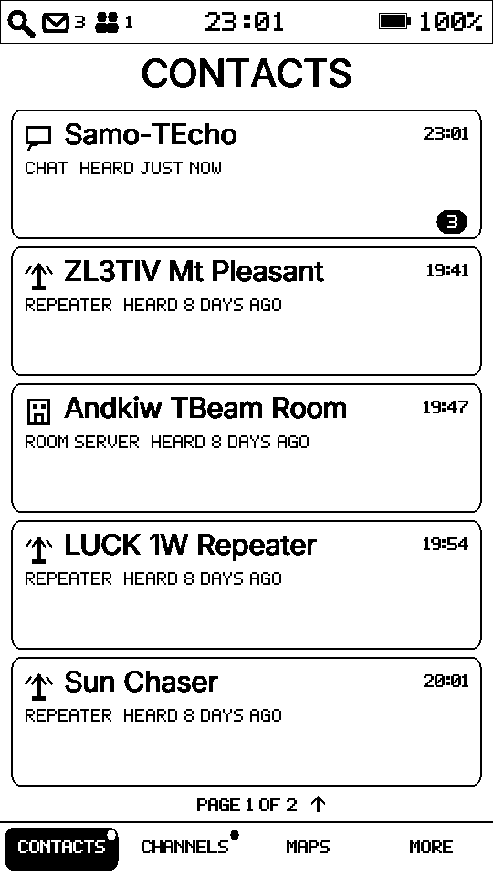<br><sub>Contacts</sub></td>
    <td align="center">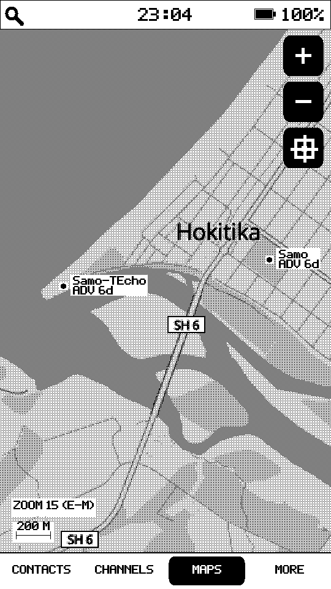<br><sub>Map</sub></td>
    <td align="center">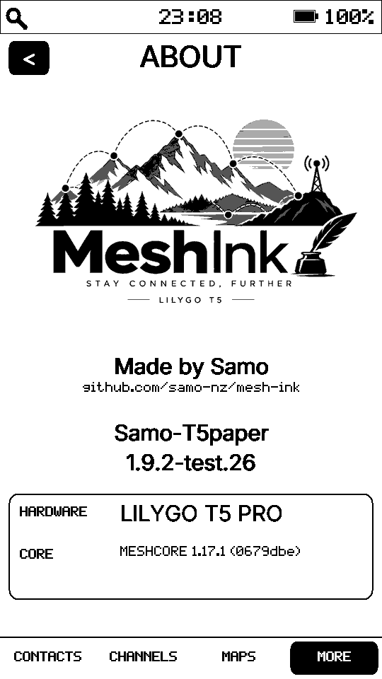<br><sub>About</sub></td>
  </tr>
</table>

<details>
<summary><strong>View more screenshots</strong></summary>

<br>

<table>
  <tr>
    <td align="center">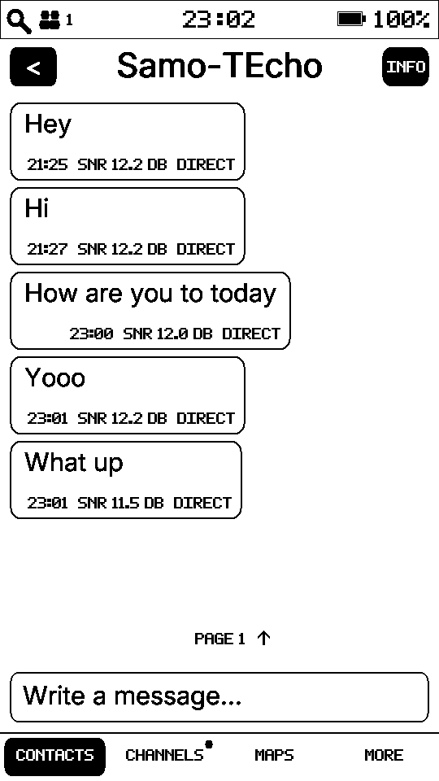<br><sub>Message</sub></td>
    <td align="center">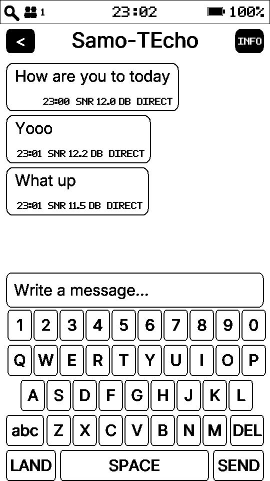<br><sub>Message keyboard</sub></td>
    <td align="center">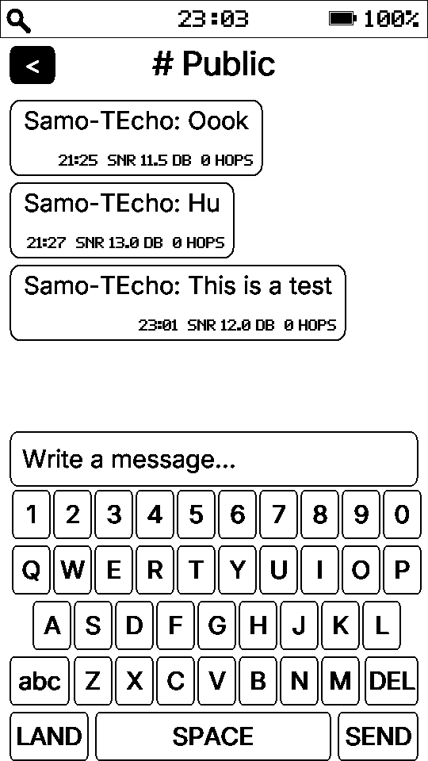<br><sub>Channel message</sub></td>
  </tr>
  <tr>
    <td align="center">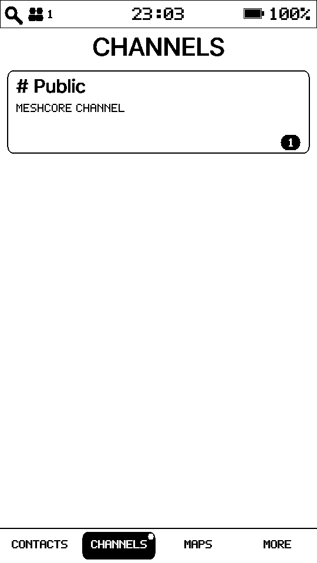<br><sub>Channels</sub></td>
    <td align="center">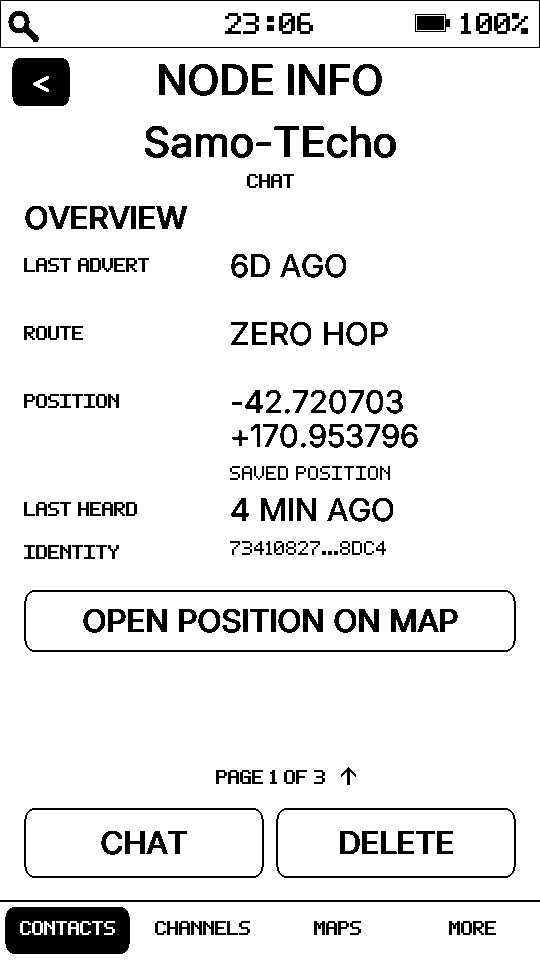<br><sub>Node information</sub></td>
    <td align="center">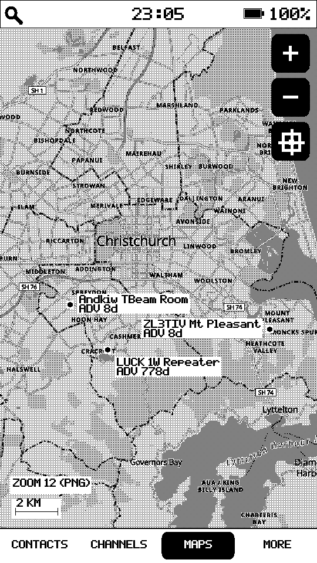<br><sub>Map — node view</sub></td>
  </tr>
  <tr>
    <td align="center">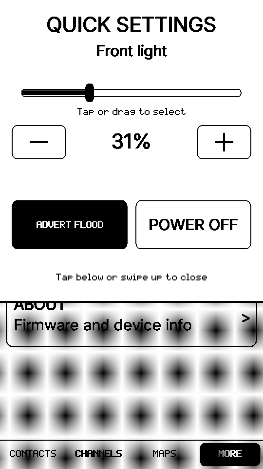<br><sub>Quick settings</sub></td>
    <td align="center">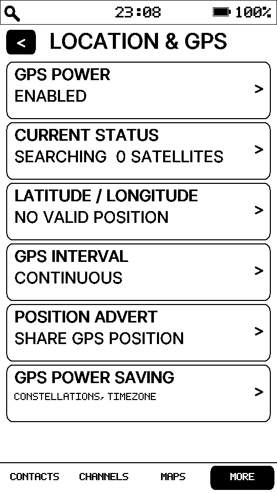<br><sub>GPS settings</sub></td>
    <td align="center">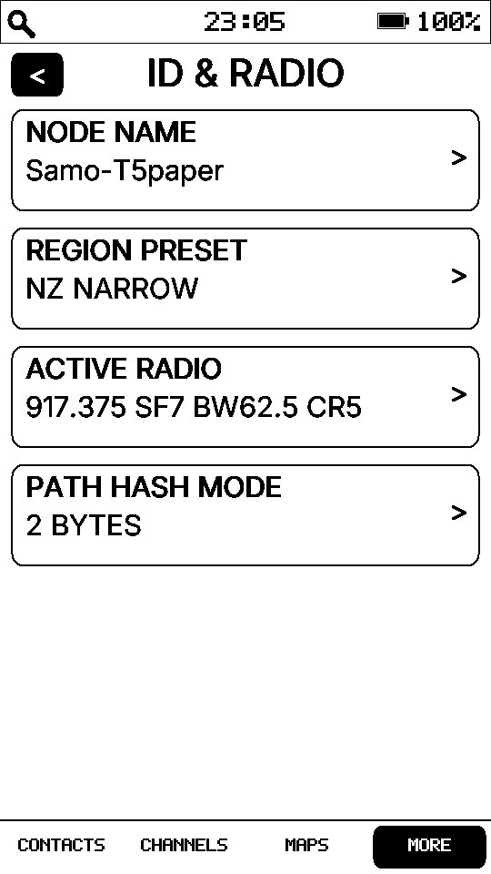<br><sub>Radio settings</sub></td>
  </tr>
  <tr>
    <td align="center">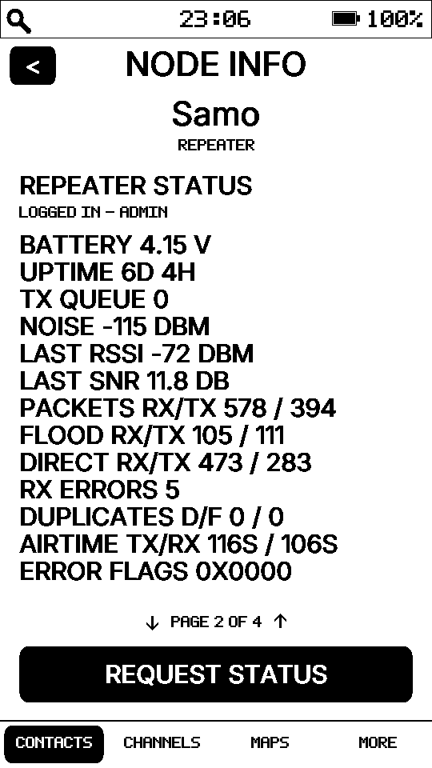<br><sub>Repeater information</sub></td>
    <td align="center">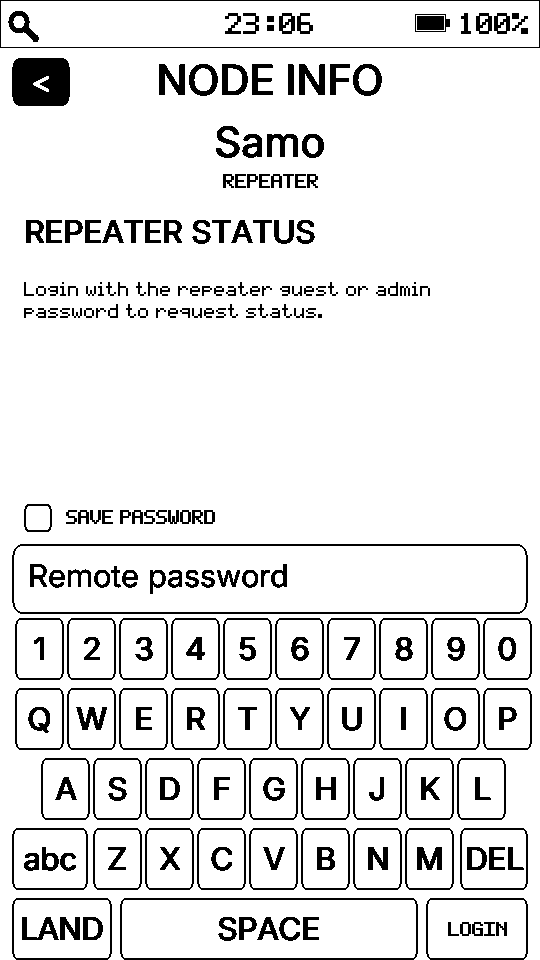<br><sub>Repeater login</sub></td>
    <td align="center">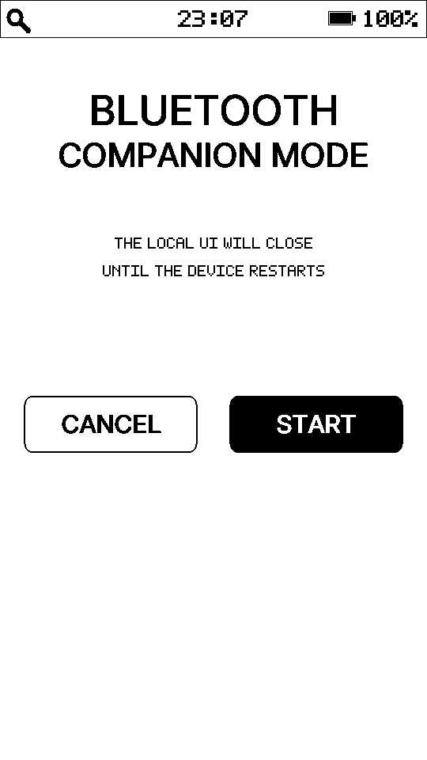<br><sub>Bluetooth companion mode</sub></td>
  </tr>
  <tr>
    <td align="center">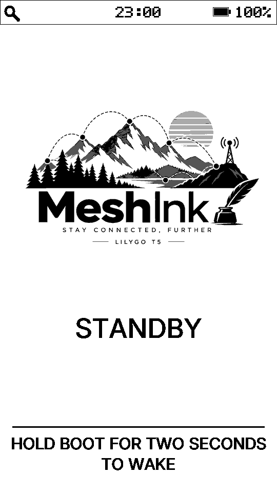<br><sub>Standby</sub></td>
    <td align="center"><br><sub>Standby — private unread</sub></td>
    <td align="center"><br><sub>Standby — unread messages</sub></td>
  </tr>
</table>

</details>

## Features

- Direct messages and channel messaging
- Contacts and node information
- Node discovery and advertisements
- Offline maps with mesh-node positions
- GPS and location sharing
- MeshCore and Meshtastic Bluetooth companion modes
- Configurable LoRa region and radio presets
- E-paper interface with frontlight controls
- Pull-down Quick Settings for brightness, advert flood and power off
- Low-power standby with long-press wake/sleep (Meshtastic normal standby; deep-sleep standby is currently MeshCore-only)
- New-message indication while in standby
- Local message history
- On-device configuration for node, radio, GPS, display and power settings

## Hardware

MeshInk currently targets the **LILYGO T5 E-Paper S3 Pro**, using its 4.7-inch 540×960 e-paper touchscreen, ESP32-S3, SX1262 LoRa radio and GPS.

## Web flasher

The easiest way to install or update MeshInk is with the **[MeshInk Web Flasher](https://samo-nz.github.io/mesh-ink/)**.

<details>
<summary><strong>Installation instructions and manual flashing</strong></summary>

### Using the web flasher

1. Open the flasher in a desktop version of **Chrome or Edge**.
2. Connect the T5 with a **USB data cable**.
3. Choose **Update** if MeshInk is already installed, or **Install MeshInk** for a new/clean installation.
4. Select the T5's USB serial port when prompted and follow the on-screen instructions.
5. If the device is not detected, hold **BOOT**, briefly press **RESET**, then release **BOOT** and try again.

### Manual installation

Download the latest release from the [MeshInk Releases](https://github.com/samo-nz/mesh-ink/releases) page. Releases contain only the unified MeshInk firmware:

- **`meshink-VERSION-update.bin`** — use this when MeshInk is already installed. Flash it at **0x10000**. It updates the application and leaves the rest of flash alone.
- **`meshink-VERSION-full-wipe.bin`** — use this for a new device or a completely clean reinstall. Flash it at **0x0**. This image is padded to the full 16 MB flash, so it overwrites old settings, messages and other stored data.

A data-capable USB cable is required. If the computer does not see the T5 in flashing mode, hold **BOOT**, press and release **RESET**, then release **BOOT**.

#### Windows

1. Install [Python](https://www.python.org/downloads/windows/) if it is not already installed. During installation, enable **Add Python to PATH**.
2. Open **Command Prompt** in the folder containing the downloaded `.bin` file.
3. Install Espressif's flashing tool:

   ```bat
   py -m pip install esptool
   ```

4. Connect the T5 by USB and put it into flashing mode if necessary. In **Device Manager → Ports**, note its COM port, for example `COM5`.
5. For a normal update:

   ```bat
   py -m esptool --chip esp32s3 -p COM5 write-flash 0x10000 meshink-VERSION-update.bin
   ```

   For a new installation / complete wipe:

   ```bat
   py -m esptool --chip esp32s3 -p COM5 write-flash 0x0 meshink-VERSION-full-wipe.bin
   ```

6. Press **RESET** after flashing if the T5 does not restart automatically.

#### macOS

1. Install [Python 3](https://www.python.org/downloads/macos/) if needed, then open **Terminal**.
2. Install esptool:

   ```sh
   python3 -m pip install --user esptool
   ```

3. Connect the T5 and put it into flashing mode if necessary. Find its port with:

   ```sh
   ls /dev/cu.*
   ```

   It will normally look like `/dev/cu.usbmodem...` or `/dev/cu.usbserial...`.

4. Change to the folder containing the downloaded firmware and flash either the update:

   ```sh
   python3 -m esptool --chip esp32s3 -p /dev/cu.YOUR_PORT write-flash 0x10000 meshink-VERSION-update.bin
   ```

   or the full wipe:

   ```sh
   python3 -m esptool --chip esp32s3 -p /dev/cu.YOUR_PORT write-flash 0x0 meshink-VERSION-full-wipe.bin
   ```

5. Press **RESET** if the T5 does not restart automatically.

#### Linux

1. Open a terminal and make sure Python 3 and pip are installed. On Debian/Ubuntu this is:

   ```sh
   sudo apt install python3 python3-pip
   python3 -m pip install --user esptool
   ```

2. Connect the T5 and put it into flashing mode if necessary. Find its port with:

   ```sh
   ls /dev/ttyACM* /dev/ttyUSB* 2>/dev/null
   ```

3. Change to the folder containing the downloaded firmware and flash either the update:

   ```sh
   python3 -m esptool --chip esp32s3 -p /dev/ttyACM0 write-flash 0x10000 meshink-VERSION-update.bin
   ```

   or the full wipe:

   ```sh
   python3 -m esptool --chip esp32s3 -p /dev/ttyACM0 write-flash 0x0 meshink-VERSION-full-wipe.bin
   ```

4. If you get a serial-port permission error, add your user to the serial-port group (commonly `dialout` on Debian/Ubuntu), log out and back in, then retry.
5. Press **RESET** if the T5 does not restart automatically.

If esptool reports that it cannot connect, repeat the BOOT/RESET sequence and try again. Espressif's [ESP32-S3 boot-mode guide](https://docs.espressif.com/projects/esptool/en/latest/esp32s3/advanced-topics/boot-mode-selection.html) has additional troubleshooting information.

> **Radio settings matter.** Select the preset appropriate for your country and local MeshCore network before transmitting.

</details>

## Using MeshInk

On first setup, choose MeshCore or Meshtastic, then configure the selected protocol's node identity and LoRa region/preset. Switching protocols under **Settings > Protocol** restarts the device while preserving the separate protocol journals and settings.

The bottom navigation provides **Contacts**, **Channels**, **Maps** and **More**. Some features, including advertisements and discovery, depend on the active protocol. From More you can open Settings or restart into its Bluetooth companion mode.

**Meshtastic pairing:** Bluetooth companion mode supports a fixed PIN or no PIN. Dynamic random PIN pairing is not supported in this release.

**Standby:** Both protocols support normal standby. Retained-radio deep-sleep standby is not implemented for Meshtastic and is not a release requirement.

**Upgrading:** Use the update image to preserve earlier MeshInk settings and MeshCore message history; a full-wipe image erases user data. Legacy Meshtastic development v3 journals are not migrated to the new v4 format.

**SD backup/restore (release-candidate hardware test):** Backup and restore now request one reboot and run before the radio/network stack starts, then continue normal startup and show the result. The MeshCore archive remains v1; official Meshtastic uses a new v2 **full-backup/full-restore only** manifest (native preferences, identity and channel keys, Meshtastic native nodes, MeshInk messages and snapshots, location and device settings). Experimental Leaf archives are not supported. New native v2 archives record the exact Meshtastic core revision; on a different or unknown revision, restore displays an **OK / Cancel** warning rather than refusing the archive. A failed final Meshtastic settings save does not cancel an offline backup: it contains the most recently persisted configuration. A worker stop timeout still prevents the reboot to avoid reading files that may be in use. Treat this as an **untested recovery feature** until restoring a full-wiped T5 and verifying identity, keys, channels, messages and nodes on real hardware has passed. Keep a separate known-good backup until that test.

A long press of the BOOT button enters or leaves standby. A short press refreshes the e-paper display.

### Quick Settings

Swipe down from the **top edge of the screen** to open Quick Settings. From here you can quickly:

- Adjust the **front-light brightness**, including turning it off.
- Send an **Advert Flood** to advertise your node across the mesh.
- **Power Off** the device.

Swipe **up** to close Quick Settings and return to the previous screen.

### Maps: controls and gestures

Open **Maps** from the bottom navigation. Drag one finger to pan; use **+** and **−** to change zoom, or tap the **target** button to centre on your device's current or last known GPS position. Tap a map node marker to open its details. While **Maps** is displayed, pinch two fingers apart/together to zoom around their starting midpoint, **double-tap** the map to zoom in one level at the first tap's location, or **triple-tap** to zoom out one level at that location.

## Offline map files

MeshInk supports the same offline map tile formats used by MeshCore and Meshtastic devices. Place them in `/maps` on the SD card. Both raw PNG tiles in folders and newer PMTiles files are supported.

A convenient way to download compatible map tiles is [Oxed's Map Tile Downloader](https://download.tiles.coalition.space/).

<details>
<summary><strong>View details on map tiles</strong></summary>

MeshInk reads 256×256 raster PNG map tiles from the SD card. Either put loose
tiles in `/maps/Z/X/Y.png`, or copy a **PMTiles v3 raster PNG** archive to
`/maps/osm-bright/osm-bright.pmtiles`, matching the tile downloader's suggested
SD-card layout. Any other `/maps/<name>/<file>.pmtiles` or
`/maps/<file>.pmtiles` layout is also supported. MeshInk discovers up to eight
archives in the maps folder and its immediate subfolders, checking them when
a loose PNG tile is unavailable. Loose tiles take priority; archives are
checked in SD-directory order. The normal parent-zoom fallback and RAM tile
cache still apply.

PMTiles directories may be uncompressed or gzip-compressed. The embedded reader
retrieves only the requested tile bytes from SD rather than unpacking the whole
archive; it supports unwrapped PNG payloads and directory sizes up to 512 KiB
after decompression. The ESP32 SD file API used here supports 32-bit seek
offsets, so tile data beyond 4 GiB is not supported. Vector tiles (MVT),
JPEG/WebP, and separately gzip-compressed tile payloads are **not** rendered.
A typical Protomaps vector `.pmtiles` map therefore needs to be rendered to
raster PNG tiles before it can be used on MeshInk.

</details>

## Building from source

The main firmware environment is:

```sh
git submodule update --init --recursive
python -m pip install Pillow
pio run -e t5-unified
```

MeshCore and Meshtastic are pinned upstream Git submodules. T5 board support and MeshInk UI/runtime code remain outside them. The pre-build script `tools/generate_core_versions.py` automatically derives each About-screen core version from that upstream code's version definition and actual checked-out Git commit, failing the build if metadata is unavailable.

The MeshInk firmware version is defined by the `T5_FIRMWARE_VERSION` build flag for the unified target.

## Development

**MeshInk was developed by Samo using ChatGPT.**

The project grew from experimentation with the LILYGO T5 hardware and MeshCore into a standalone dual-protocol e-paper mesh client.

## Acknowledgements

MeshInk is built on the work of several open-source projects. Many thanks to their developers and contributors:

- [MeshCore](https://github.com/meshcore-dev/MeshCore) — original MeshCore networking protocol integrated in MeshInk.
- [Meshtastic](https://github.com/meshtastic/firmware) — official Meshtastic networking core integrated alongside MeshCore.
- [EPDiy](https://github.com/vroland/epdiy) — e-paper display support.
- [PNGdec](https://github.com/bitbank2/PNGdec) — embedded PNG decoding.
- [miniz](https://github.com/richgel999/miniz) — compression and decompression support.
- [MicroNMEA](https://github.com/stevemarple/MicroNMEA) — GPS/NMEA parsing.
- [Adafruit BusIO](https://github.com/adafruit/Adafruit_BusIO) — hardware bus abstractions.
- [base64](https://github.com/Densaugeo/base64_arduino) — Base64 encoding and decoding.
- [Aurora](https://github.com/jetaudio/crosspoint-aurora) — CrossPoint Reader fork for the T5 E-Paper. No code is used directly, but the project was very helpful when developing MeshInk's responsive display handling.

Thank you to everyone who develops and maintains these projects. MeshInk would not exist without their work.


### test.56 recovery safety
Before any destructive restore, copy the verified SD backup to a computer or second SD card. Test restoration on a spare T5 where possible. The backup checks journal headers and Meshtastic node snapshot checksums; damaged histories are never silently advertised as backed up. The restore checks the staged copies before replacing live flash and keeps existing rollback safety copies from being overwritten. Successful restores free their temporary copies. CI passing is not proof of full hardware recovery.


### test.57 confirmation and reboot display
Backup and Restore both require an explicit confirmation screen with **OK / Cancel** describing the one-shot reboot before protocol startup. No operation is queued until OK. After confirmation, a non-interactive **REBOOTING...** progress screen is refreshed *before* native worker shutdown, so its deferred save/stop operation no longer looks like a frozen confirmation screen. Restore revision warnings and the optional operation cancellation remain available. The Meshtastic startup FreeRTOS queue assertion observed after the test.56 backup is being investigated separately and must pass a hardware reboot regression before release approval.


### test.57 SD mount crash correction
After successful offline B+R, normal startup previously called `map_tiles_warm_storage()`, which attempted to reinitialize an already-mounted SD filesystem. This could invoke `SDFS::end()` / `SPIClass::endTransaction()` and trigger a FreeRTOS queue assert. The board storage backend now reuses readable existing mounts and only tears down an SD mount when a real remount is needed. A separate confirmation/progress screen is shown before flushing the protocol for the requested reboot.

For future hardware crash reports, the matching primary-build `firmware.elf` is now retained as a separate CI artifact named with its exact commit SHA, so backtraces can be resolved without a speculative rebuild.


### test.58 human-readable backup filenames
When the device has a trusted RTC, new SD backups record the **local date and time at the UI confirmation tap**, including the current timezone: `meshink-tastic-YYYY-MM-DD-HH-MM.BAK` for native Meshtastic and `meshink-core-YYYY-MM-DD-HH-MM.BAK` for MeshCore. Same-minute duplicates gain a `-01` through `-99` suffix; no existing archive is overwritten. Without trustworthy time, the proven numbered `MTBK0001.BAK` / `MCBK0001.BAK` fallback remains. Existing archives keep their existing names and are still visible and restorable. SD long filename support is enabled explicitly for the production cache64 build. The on-disk archive *content* format is unchanged.


### test.59 restore-file selection audit
Reviewed the entire archive basename path: SD enumeration, stable in-memory entry storage, touchscreen row selection, full content/revision checks, persistent NVS reboot request, and pre-protocol restore opener. Fixed two selection risks: the list now always retains the **newest 24 valid backups regardless of FAT directory enumeration order**, and correctly ranks `-01`, `-02` collisions after their original minute backup. Full long names are shown over two lines with their suffix intact, and the selected archive filename is repeated on the final Restore confirmation before OK can schedule a destructive operation. Original numbered archives remain supported. Automated host tests and firmware build are required; hardware restore of the new long-name archive is still outstanding.


### test.60 WarmStore evidence and plain logs
Official Meshtastic `/prefs/warm.dat` header warnings require a read-only investigation before attempting repairs. During native Meshtastic initialization (after SPIFFS mount, before NodeDB), the serial log reports `[MT-WARM]` filename, file size, count of header bytes read, snapshot header magic and record count for **both** `/prefs/warm.dat` and the possible `/prefs/warm.dat.tmp`. No node identities/keys are printed, and neither file is modified or deleted. The unchanged, pinned Meshtastic source receives an **idempotent, build-only** patch disabling ANSI colour escapes in both official logger paths. Multiple threads can still interleave serial characters; no logging serialization change is attempted.


### test.61: Serial log line integrity
On the H752-01 ESP32-S3 HWCDC USB serial port, native Meshtastic's `log_to_serial` previously emitted its timestamp, severity, thread tag and message as separate `printf`/`Print::write` calls, causing interleaving and potentially dropped characters under simultaneous MeshInk e-paper and PhoneAPI logs. The pinned official Meshtastic source remains unchanged: an idempotent **build-only** adapter formats each record in bounded stack storage and performs a single `dest->write(buffer,size)` call. Arduino HWCDC serializes that buffer write with its own driver lock. This preserves severity, text and other Bluetooth/syslog paths and builds on the test.60 ANSI-colour removal. Native log-line format host checks added; actual concurrent USB log quality still needs hardware observation. No changes made to WarmStore or backup/restore logic.


### test.62: USB CDC output under Meshtastic PhoneAPI startup bursts
The test.61 hardware log shows Meshtastic DEBUG/INFO lines no longer interleaving, but two MeshInk `Serial.printf` diagnostics are partially missing and long RF replay lines were clipped by a fixed 160-byte body buffer. ESP32-S3 Arduino HWCDC defaults to a 256-byte TX ring; `HWCDC::write` can return a partial write on congested USB. Set a 4096-byte TX ring once, **before** the unified boot's `Serial.begin`, avoiding replacing a live queue. Increase native Meshtastic body buffer to 384 bytes and atomic record cap to 512 bytes. No extra blocking retries, radio-worker policy, logging level or data-store changes. Host tests cover long log lines. Test.62 hardware log remains required to verify that the rare incomplete MeshInk `Serial.printf` lines are gone.


### Test.63: full-wipe restore failure triage and safe repeatability
The 2.1.1-test.61 user full-wipe MeshCore restore failed AFTER archive validation/staging and returned `Restore aborted; original data recovered`. The subsequent retry refused `Existing restore salvage files; refusing overwrite`. Code investigation found an independent rollback-cleanup defect: virtual NVS stages (`@node-name`, `@device-settings`, etc.) copy old values into `/rstNN.old` but successful rollback removed staged `.tmp` and the txn marker **without deleting those `.old` copies**, stranding files that permanently block future restores. Fixed that for **new** rollback transactions, leaving any pre-existing orphan `.old` files untouched. Added archive/device-settings preflight and phase/slot/path diagnostics to distinguish file rename failure from NVS-apply failure; no keys or payloads are logged. On the first welcome screen, `RESTORE FROM SD` and `NEXT` are neither displayed nor clickable until the user selects a protocol. **Do not delete old salvage files or retry the existing wiped device until copies have been secured and the first failure investigated.** No WarmStore or radio changes.


### Test.63 follow-up: leave test.61 rollback evidence untouched
A second attempt on the full-wiped test.61 device refused `Existing restore salvage files; refusing overwrite`. Correct safety behaviour for the legacy `/rstNN.old` namespace, but the snapshots were orphaned by the old successful-rollback cleanup defect. New test.63 restore transactions use **isolated** `/r2sNN.tmp` and `/r2sNN.old` names; they never touch preexisting `/rstNN.old` files and reject *any* preexisting files in their own namespace before writing. Crash recovery accepts both old and new stage prefixes. Future complete rollbacks clean their NVS rollback snapshots. To preserve evidence, first make a **read-only** full flash backup of the current device before flashing the update image and attempting restore. No automatic salvage deletion, SPIFFS reformat or full-wipe is performed.
