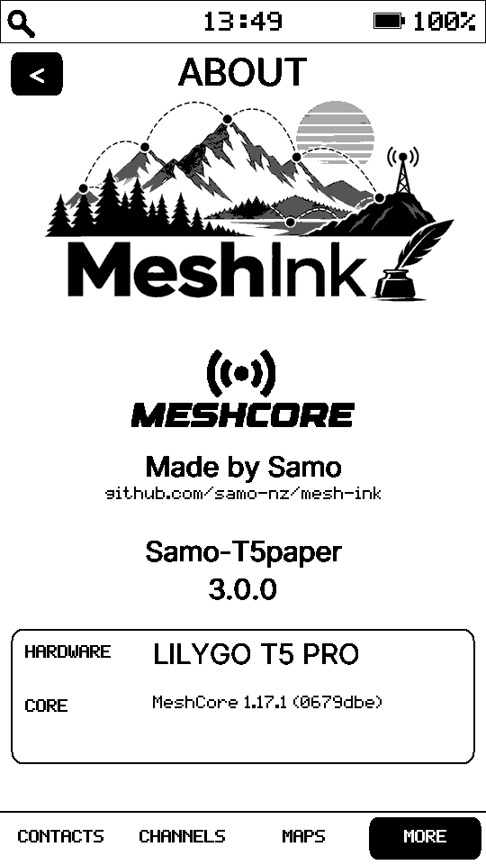
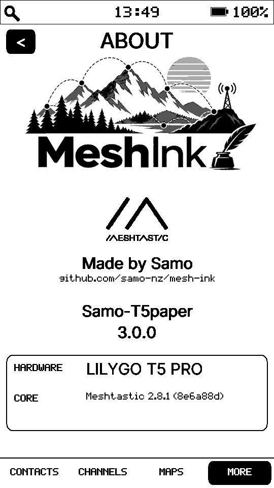

# MeshInk 3.1.0

<p align="center">
  
</p>

**Stay Connected, Further.**

MeshInk turns the **LILYGO T5 E-Paper S3 Pro** into a standalone touchscreen mesh communicator supporting **MeshCore and Meshtastic**.

Send private or channel messages, explore offline maps, discover nodes and share your location — without needing a phone or internet connection. Built for fast, responsive touchscreen interaction, MeshInk puts special emphasis on a smooth, practical on-screen keyboard for everyday messaging. Choose your network during setup or switch later in **Settings > Protocol**. Each protocol keeps its own settings and message history.

## Screenshots

<table>
  <tr>
    <td align="center"><br><sub>Contacts</sub></td>
    <td align="center"><br><sub>Map</sub></td>
    <td align="center"><br><sub>About — MeshCore</sub></td>
  </tr>
</table>

<details>
<summary><strong>View more screenshots</strong></summary>

<br>

<table>
  <tr>
    <td align="center"><br><sub>About — Meshtastic</sub></td>
    <td align="center"><br><sub>Message keyboard</sub></td>
    <td align="center"><br><sub>Channel message</sub></td>
  </tr>
  <tr>
    <td align="center"><br><sub>Channels</sub></td>
    <td align="center"><br><sub>Node information</sub></td>
    <td align="center"><br><sub>Map — node view</sub></td>
  </tr>
  <tr>
    <td align="center"><br><sub>Quick settings</sub></td>
    <td align="center"><br><sub>GPS settings</sub></td>
    <td align="center"><br><sub>Radio settings</sub></td>
  </tr>
  <tr>
    <td align="center"><br><sub>Repeater information</sub></td>
    <td align="center"><br><sub>Repeater login</sub></td>
    <td align="center"><br><sub>Bluetooth companion mode</sub></td>
  </tr>
  <tr>
    <td align="center"><br><sub>Standby</sub></td>
    <td align="center"><br><sub>Standby — private unread</sub></td>
    <td align="center"><br><sub>Standby — unread messages</sub></td>
  </tr>
</table>

</details>

## Features

- **Two networks, one device** — Switch between MeshCore and Meshtastic (one active at a time).
- **Standalone messaging** — Private and channel messages on the touchscreen.
- **Fast, responsive typing** — Portrait and landscape keyboards with UTF-8 accented-character alternatives on long-press, an emoji picker with 34 choices, and Unicode-aware message editing.
- **Offline maps** — View maps and mesh-node locations without internet.
- **GPS and location sharing** — Find your position and choose when to share it.
- **Contacts and discovery** — Find nodes and manage contacts.
- **Bluetooth companion mode** — Connect to compatible MeshCore or Meshtastic apps.
- **E-paper touchscreen** — Easy-to-use interface with adjustable frontlight.
- **Battery-friendly standby** — Low-power standby and unread-message indications.
- **Customisable settings** — Radio, GPS, display and power preferences.
- **SD card support** — Offline maps and device backup/restore.

### New in 3.1.0

- **International typing** — Long-press characters for accented letters and punctuation alternatives on portrait or landscape keyboards.
- **Emoji messaging** — 34 selectable emoji, with ten frequent shortcuts on the symbols row and a compact landscape selection panel.
- **UTF-8-aware composition** — Correct character boundaries for wrapping, editing, backspace and display clipping.
- **Meshtastic message progress** — Show actual retry progress for acknowledged direct messages and the final delivery/failure outcome.

## Hardware

MeshInk currently targets the **LILYGO T5 E-Paper S3 Pro**, using its 4.7-inch 540×960 e-paper touchscreen, ESP32-S3, SX1262 LoRa radio and GPS.

## Web flasher

The easiest way to install or update MeshInk is with the **[MeshInk Web Flasher](https://samo-nz.github.io/mesh-ink/)**.

<details>
<summary><strong>Installation instructions and manual flashing</strong></summary>

### Using the web flasher

1. Open the flasher in a desktop version of **Chrome or Edge**.
2. Connect the T5 with a **USB data cable**.
3. Choose **Update** if MeshInk is already installed, or **Install MeshInk** for a new/clean installation.
4. Select the T5's USB serial port when prompted and follow the on-screen instructions.
5. If the device is not detected, hold **BOOT**, briefly press **RESET**, then release **BOOT** and try again.

### Manual installation

Download the latest release from the [MeshInk Releases](https://github.com/samo-nz/mesh-ink/releases) page. Releases contain only the unified MeshInk firmware:

- **`meshink-VERSION-update.bin`** — use this when MeshInk is already installed. Flash it at **0x10000**. It updates the application and leaves the rest of flash alone.
- **`meshink-VERSION-full-wipe.bin`** — use this for a new device or a completely clean reinstall. Flash it at **0x0**. This image is padded to the full 16 MB flash, so it overwrites old settings, messages and other stored data.

A data-capable USB cable is required. If the computer does not see the T5 in flashing mode, hold **BOOT**, press and release **RESET**, then release **BOOT**.

#### Windows

1. Install [Python](https://www.python.org/downloads/windows/) if it is not already installed. During installation, enable **Add Python to PATH**.
2. Open **Command Prompt** in the folder containing the downloaded `.bin` file.
3. Install Espressif's flashing tool:

   ```bat
   py -m pip install esptool
   ```

4. Connect the T5 by USB and put it into flashing mode if necessary. In **Device Manager → Ports**, note its COM port, for example `COM5`.
5. For a normal update:

   ```bat
   py -m esptool --chip esp32s3 -p COM5 write-flash 0x10000 meshink-VERSION-update.bin
   ```

   For a new installation / complete wipe:

   ```bat
   py -m esptool --chip esp32s3 -p COM5 write-flash 0x0 meshink-VERSION-full-wipe.bin
   ```

6. Press **RESET** after flashing if the T5 does not restart automatically.

#### macOS

1. Install [Python 3](https://www.python.org/downloads/macos/) if needed, then open **Terminal**.
2. Install esptool:

   ```sh
   python3 -m pip install --user esptool
   ```

3. Connect the T5 and put it into flashing mode if necessary. Find its port with:

   ```sh
   ls /dev/cu.*
   ```

   It will normally look like `/dev/cu.usbmodem...` or `/dev/cu.usbserial...`.

4. Change to the folder containing the downloaded firmware and flash either the update:

   ```sh
   python3 -m esptool --chip esp32s3 -p /dev/cu.YOUR_PORT write-flash 0x10000 meshink-VERSION-update.bin
   ```

   or the full wipe:

   ```sh
   python3 -m esptool --chip esp32s3 -p /dev/cu.YOUR_PORT write-flash 0x0 meshink-VERSION-full-wipe.bin
   ```

5. Press **RESET** if the T5 does not restart automatically.

#### Linux

1. Open a terminal and make sure Python 3 and pip are installed. On Debian/Ubuntu this is:

   ```sh
   sudo apt install python3 python3-pip
   python3 -m pip install --user esptool
   ```

2. Connect the T5 and put it into flashing mode if necessary. Find its port with:

   ```sh
   ls /dev/ttyACM* /dev/ttyUSB* 2>/dev/null
   ```

3. Change to the folder containing the downloaded firmware and flash either the update:

   ```sh
   python3 -m esptool --chip esp32s3 -p /dev/ttyACM0 write-flash 0x10000 meshink-VERSION-update.bin
   ```

   or the full wipe:

   ```sh
   python3 -m esptool --chip esp32s3 -p /dev/ttyACM0 write-flash 0x0 meshink-VERSION-full-wipe.bin
   ```

4. If you get a serial-port permission error, add your user to the serial-port group (commonly `dialout` on Debian/Ubuntu), log out and back in, then retry.
5. Press **RESET** if the T5 does not restart automatically.

If esptool reports that it cannot connect, repeat the BOOT/RESET sequence and try again. Espressif's [ESP32-S3 boot-mode guide](https://docs.espressif.com/projects/esptool/en/latest/esp32s3/advanced-topics/boot-mode-selection.html) has additional troubleshooting information.

> **Radio settings matter.** Select the preset appropriate for your country and local MeshCore network before transmitting.

</details>

## Using MeshInk

Choose MeshCore or Meshtastic at setup. Switch later under **Settings > Protocol**; the device restarts and keeps each network's settings and messages separate.

Use **Contacts**, **Channels**, **Maps** and **More** to explore the device. Some features depend on the selected network. Bluetooth companion mode is available from More.

**Standby:** Both protocols support normal standby. Deep-sleep standby is currently MeshCore-only.

**Backups:** Back up or restore your settings and messages using an SD card. Keep a separate copy of important backups before a full reinstall.

**Updating:** Choose **Update** in the web flasher to preserve existing data. A clean install erases stored data. Older experimental Meshtastic message journals are not migrated.

Long-press **BOOT** to enter or leave standby; short-press to refresh the display.

### Quick Settings

Swipe down from the top edge to adjust frontlight brightness, send a MeshCore advert flood when available, or power off. Swipe up to close.

### Maps

Drag to pan, pinch to zoom, double-tap to zoom in, or triple-tap to zoom out. Use **+**, **−**, and the target button for zoom and recentring; tap a node marker for details.

## Offline map files

MeshInk supports the same offline map tile formats used by MeshCore and Meshtastic devices. Place them in `/maps` on the SD card. Both raw PNG tiles in folders and newer PMTiles files are supported.

A convenient way to download compatible map tiles is [Oxed's Map Tile Downloader](https://download.tiles.coalition.space/).

<details>
<summary><strong>View details on map tiles</strong></summary>

MeshInk reads 256×256 raster PNG map tiles from the SD card. Either put loose
tiles in `/maps/Z/X/Y.png`, or copy a **PMTiles v3 raster PNG** archive to
`/maps/osm-bright/osm-bright.pmtiles`, matching the tile downloader's suggested
SD-card layout. Any other `/maps/<name>/<file>.pmtiles` or
`/maps/<file>.pmtiles` layout is also supported. MeshInk discovers up to eight
archives in the maps folder and its immediate subfolders, checking them when
a loose PNG tile is unavailable. Loose tiles take priority; archives are
checked in SD-directory order. The normal parent-zoom fallback and RAM tile
cache still apply.

PMTiles directories may be uncompressed or gzip-compressed. The embedded reader
retrieves only the requested tile bytes from SD rather than unpacking the whole
archive; it supports unwrapped PNG payloads and directory sizes up to 512 KiB
after decompression. The ESP32 SD file API used here supports 32-bit seek
offsets, so tile data beyond 4 GiB is not supported. Vector tiles (MVT),
JPEG/WebP, and separately gzip-compressed tile payloads are **not** rendered.
A typical Protomaps vector `.pmtiles` map therefore needs to be rendered to
raster PNG tiles before it can be used on MeshInk.

</details>

## Building from source

The main firmware environment is:

```sh
git submodule update --init --recursive
python -m pip install Pillow
pio run -e t5-unified
```

MeshCore and Meshtastic are pinned upstream Git submodules. T5 board support and MeshInk UI/runtime code remain outside them. The pre-build script `tools/generate_core_versions.py` automatically derives each About-screen core version from that upstream code's version definition and actual checked-out Git commit, failing the build if metadata is unavailable.

The MeshInk firmware version is defined by the `T5_FIRMWARE_VERSION` build flag for the unified target.

## Development

**MeshInk was developed by Samo using ChatGPT.**

The project grew from experimentation with the LILYGO T5 hardware and MeshCore into a standalone dual-protocol e-paper mesh client.

## Acknowledgements

MeshInk is built on the work of several open-source projects. Many thanks to their developers and contributors:

- [MeshCore](https://github.com/meshcore-dev/MeshCore) — original MeshCore networking protocol integrated in MeshInk.
- [Meshtastic](https://github.com/meshtastic/firmware) — official Meshtastic networking core integrated alongside MeshCore.
- [EPDiy](https://github.com/vroland/epdiy) — e-paper display support.
- [PNGdec](https://github.com/bitbank2/PNGdec) — embedded PNG decoding.
- [miniz](https://github.com/richgel999/miniz) — compression and decompression support.
- [MicroNMEA](https://github.com/stevemarple/MicroNMEA) — GPS/NMEA parsing.
- [Adafruit BusIO](https://github.com/adafruit/Adafruit_BusIO) — hardware bus abstractions.
- [base64](https://github.com/Densaugeo/base64_arduino) — Base64 encoding and decoding.
- [Aurora](https://github.com/jetaudio/crosspoint-aurora) — CrossPoint Reader fork for the T5 E-Paper. No code is used directly, but the project was very helpful when developing MeshInk's responsive display handling.

Thank you to everyone who develops and maintains these projects. MeshInk would not exist without their work.
